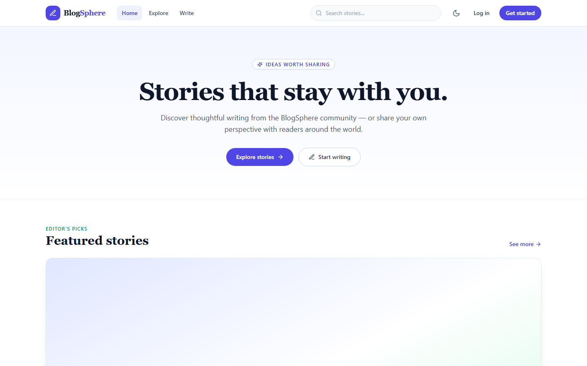
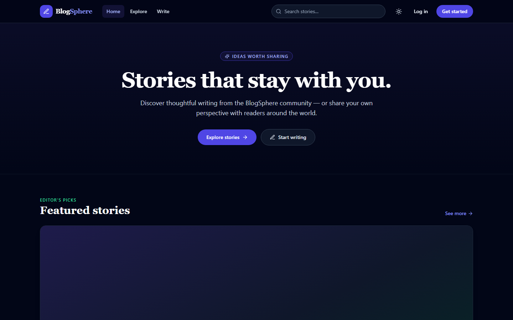
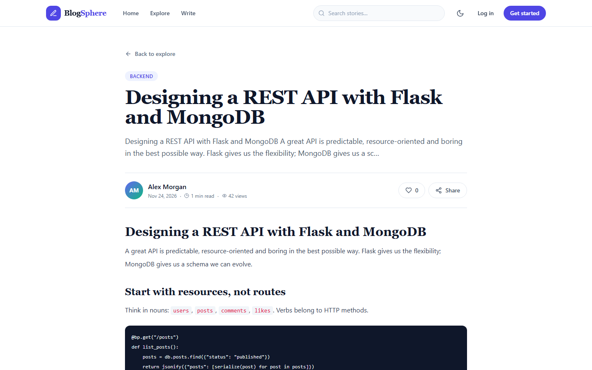
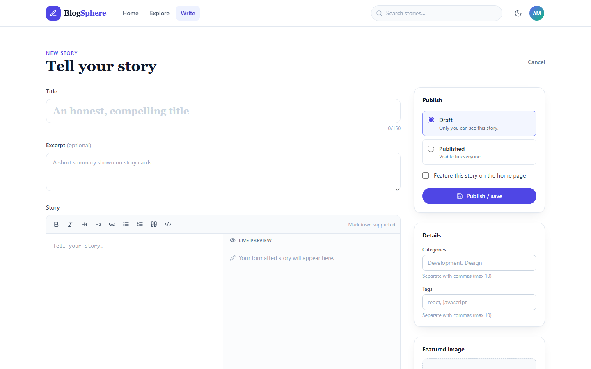
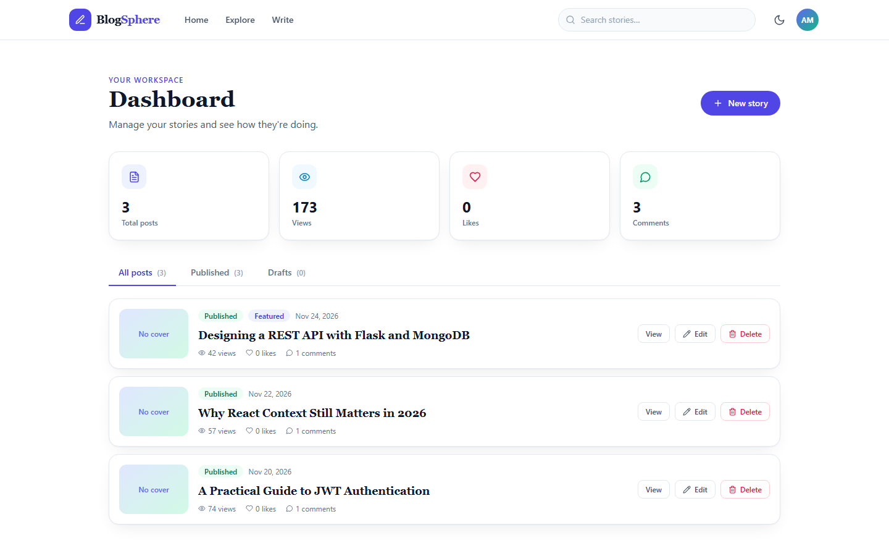
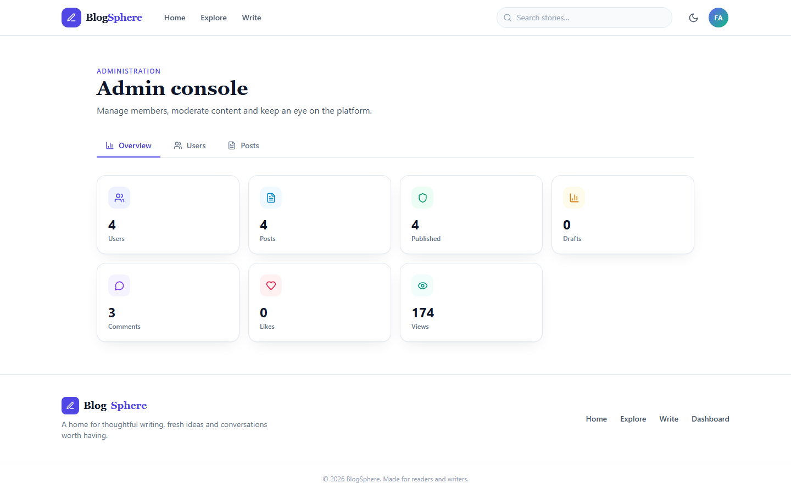
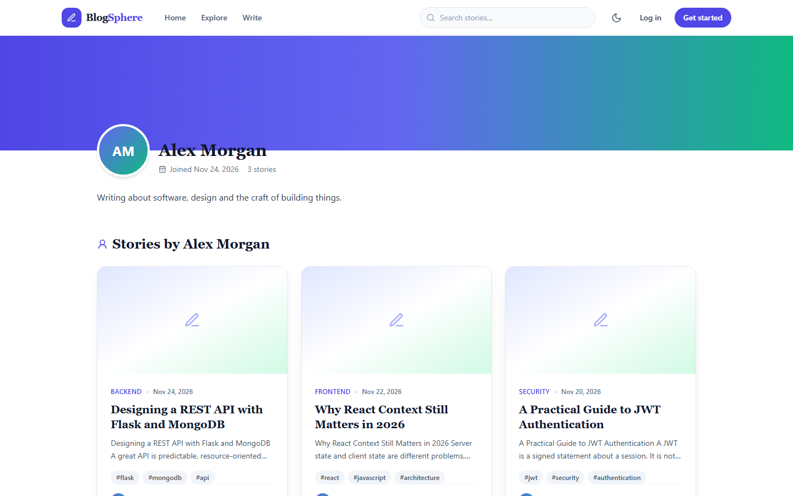
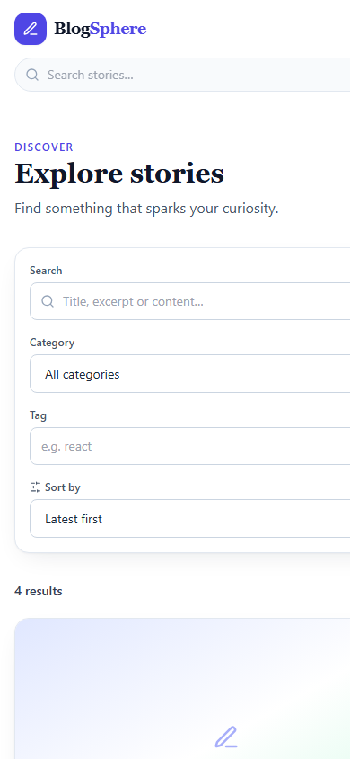

# BlogSphere

A modern, full-stack blogging platform inspired by Medium. BlogSphere lets readers discover stories, lets writers publish and manage their work, and gives administrators a console to moderate the community.

Built with **React + Vite + Tailwind CSS** on the front end, **Flask + PyMongo** on the back end, **MongoDB** for persistence, and **JWT + bcrypt** for authentication. No mock data: every screen talks to the REST API and the database.

---

## Features

### Authentication & profiles
- Register, log in, log out (server-side token revocation)
- Bcrypt password hashing, signed JWT sessions, protected routes
- Editable profiles (name, bio, avatar, website) and password change
- Admin role via configurable email allow-list

### Writing & publishing
- Create, edit and delete posts (authors and admins only)
- Markdown editor with toolbar and live preview
- Featured image uploads, categories, tags, drafts and publishing
- Unique slugs, canonical article pages, publication dates and authors

### Discovery & interaction
- Homepage with featured stories and paginated recent posts
- Full-text-ish search, category/tag filters, newest/popular/oldest sorting
- Nested comments with replies, edits and deletes
- Like/unlike with per-user uniqueness and live counts
- View tracking, read time, responsive light/dark UI and toast notifications

### Dashboards
- Author dashboard: published/draft tabs, views, likes, comments, quick edit/delete
- Admin console: platform statistics, user management, role changes, content moderation

---

## Tech stack

| Layer | Technology |
| --- | --- |
| Frontend | React, Vite, Tailwind CSS, React Router, Axios, React Markdown |
| Backend | Python, Flask, Flask-CORS, PyMongo |
| Database | MongoDB (local or Atlas) |
| Auth | PyJWT, bcrypt |
| Testing | pytest (API integration tests) |
| Deployment | Render (API), Vercel (SPA), MongoDB Atlas |

---

## Quick start

### Prerequisites
- Node.js 18+ and npm
- Python 3.10+ and pip
- MongoDB running locally on `localhost:27017` (or an Atlas URI)

### 1. Clone and configure

```bash
git clone https://github.com/<your-username>/blogsphere.git
cd blogsphere
cp backend/.env.example backend/.env
cp frontend/.env.example frontend/.env
```

Edit `backend/.env` and set at minimum `JWT_SECRET` and `FLASK_SECRET_KEY` to long random strings. Add your email to `ADMIN_EMAILS` to get an admin account when you register.

### 2. Backend

```bash
cd backend
python -m venv .venv
# Windows: .venv\Scripts\activate    |    macOS/Linux: source .venv/bin/activate
pip install -r requirements.txt
python run.py
```

API is available at `http://localhost:5000/api` (health check: `/api/health`).

Optional demo content (writes real records to MongoDB):

```bash
python seed.py
```

Demo accounts: `admin@blogsphere.local` and `author@blogsphere.local`, password `DemoPassword123` (override with `SEED_PASSWORD`).

### 3. Frontend

```bash
cd frontend
npm install
npm run dev
```

Open `http://localhost:5173`. Vite proxies `/api` and `/uploads` to the Flask server, so no CORS configuration is needed locally.

### 4. Tests

```bash
cd backend
python -m pytest -q
```

The suite uses a dedicated `blogsphere_test` database and exercises registration, login, logout, profile updates, post CRUD, drafts, filters, comments, replies, likes and authorization against real MongoDB.

---

## Repository layout

```text
blog-website/
├── backend/
│   ├── app/
│   │   ├── routes/        # auth, users, posts, comments, likes, uploads, admin, health
│   │   ├── config.py      # environment-driven configuration
│   │   ├── database.py    # PyMongo client, indexes, request-scoped DB
│   │   ├── decorators.py  # require_auth, optional_auth, require_admin
│   │   ├── errors.py      # centralized JSON error handlers
│   │   ├── security.py    # bcrypt + JWT + token blacklist
│   │   ├── serializers.py # document -> JSON mappers
│   │   └── utils.py       # validation, pagination, slugs
│   ├── tests/             # pytest integration tests
│   ├── seed.py            # optional real-data seed
│   ├── run.py
│   └── requirements.txt
├── frontend/
│   └── src/
│       ├── api/ or lib/   # Axios client and helpers
│       ├── components/    # reusable UI
│       ├── context/       # auth, theme, toasts
│       └── pages/         # routes
├── docs/
│   ├── API.md             # full REST reference
│   ├── ARCHITECTURE.md    # design and data model
│   ├── DEPLOYMENT.md      # Render + Vercel + Atlas
│   └── TESTING.md         # test plan and manual checks
├── screenshots/           # UI captures (see screenshots/README.md)
├── render.yaml
├── frontend/vercel.json
├── .env.example
└── LICENSE
```

---

## Screenshots

| | |
| --- | --- |
|  |  |
|  |  |
|  |  |
|  |  |

---

## Documentation

- [API reference](docs/API.md)
- [Architecture](docs/ARCHITECTURE.md)
- [Deployment guide](docs/DEPLOYMENT.md)
- [Testing guide](docs/TESTING.md)

---

## Production build

```bash
cd frontend && npm run build       # output: frontend/dist
cd ../backend && gunicorn 'run:app' --bind 0.0.0.0:$PORT
```

Set `VITE_API_URL=https://<your-render-app>.onrender.com/api` before the frontend build, and set `CORS_ORIGINS=https://<your-vercel-app>.vercel.app` on the backend. See [docs/DEPLOYMENT.md](docs/DEPLOYMENT.md) for the full walkthrough.

---

## Security notes

- Passwords are never stored in plain text; bcrypt hashes are stored instead.
- JWT signing keys come from environment variables and must be rotated if exposed.
- Logout inserts the token into a TTL-indexed blacklist collection.
- Every mutating endpoint re-checks ownership on the server; the UI is only a convenience.
- Validation happens before writes, and unexpected exceptions become uniform JSON errors.
- Uploads are restricted by extension and a 5 MB request limit.

---

## License

[MIT](LICENSE) — see `LICENSE` for details.
